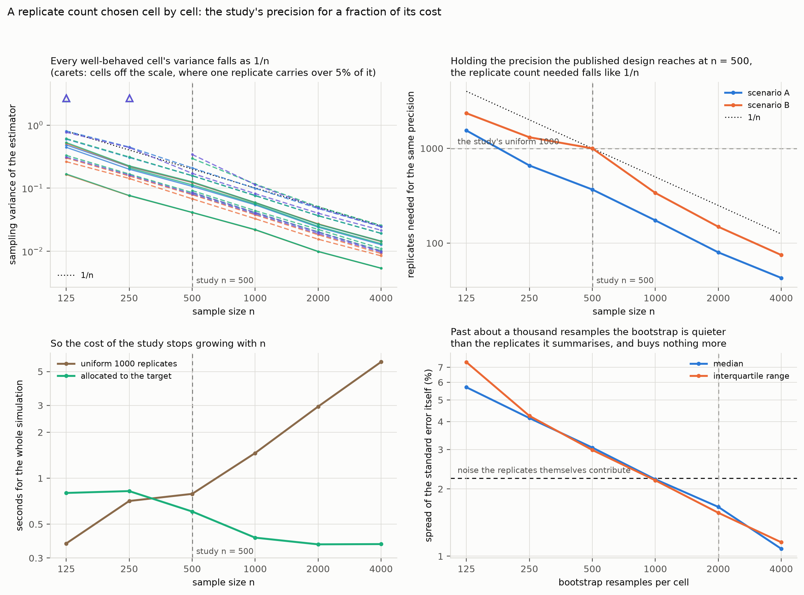

# Simulation budget: what the uniform design spends to no purpose

The study of Unit 2 runs 1,000 replicates of every cell. That is a single
number applied to twenty cells whose estimators differ in dispersion by a
factor of three, at a sample size that could have been any of six. This
document asks what that number should have been, and finds that the published
design spends about a sixth of its simulation time, and well over half of its
analysis time, buying precision it does not report.

The larger result is about the sample size. Monte Carlo precision depends on
the replicate count and on the dispersion of the estimator, and that dispersion
falls like `1/n`. Cost per replicate rises like `n`. The two cancel: **once the
replicate count is allowed to follow the precision it buys, the cost of this
study stops depending on `n` at all.**

| at `n = 500` | uniform | budgeted | |
|---|---|---|---|
| replicates, scenario A | 1,000 | **475** | |
| replicates, scenario B | 1,000 | 1,000 | unchanged |
| `simulate` | 0.727 s | **0.608 s** | 16% less |
| `analyze` | 0.882 s | **0.378 s** | 57% less |
| both stages | 1.609 s | **0.986 s** | **39% less** |
| worst Monte Carlo standard error, any cell, any measure | — | — | **unchanged** |

| holding that same precision | uniform | budgeted | |
|---|---|---|---|
| simulation at `n = 500` | 0.79 s | 0.61 s | 23% less |
| simulation at `n = 1000` | 1.46 s | 0.41 s | 72% less |
| simulation at `n = 2000` | 2.95 s | 0.37 s | 87% less |
| simulation at `n = 4000` | 5.78 s | **0.37 s** | **94% less** |

Nothing in `config.py` was changed. The study still runs the design it was
submitted with; what follows is the measurement of what that design costs and
what a different one would cost, which is the question the extension asks.

## How to reproduce these numbers

```
make budget            # the pilot, the cost model, and the allocation
make perf-figures      # redraws results/figures/budget.png from the CSVs
python3 -m pytest -q tests/test_budget.py
```

Hardware, versions and timing method are as in [BASELINE.md](BASELINE.md):
Apple M3 with 8 cores, every timing the smallest of three runs after a
discarded warm-up, and all timings taken on an otherwise idle machine. The
budget study writes eight CSVs into `results/benchmarks/budget_*.csv` and one
figure, `results/figures/budget.png`.

Two kinds of second are quoted below, and they differ slightly. Section 9 and
the first headline table are direct timings of the stages as `make` runs them.
The cost columns of sections 3, 5 and 7 come from the per-replicate cost model,
which sums two separate single-scenario runs and so charges the fixed overhead
of a run twice: it reads 0.79 s where a combined run of the same design
measures 0.73 s. Comparisons within a table are unaffected, since both of its
columns are built the same way.

## 1. The pilot

`src/budget.py` runs 2,000 replicates of every cell at each of
`n = 125, 250, 500, 1000, 2000, 4000`, and records, per cell:

- the standard deviation of the estimates across replicates, which is what
  every Monte Carlo standard error is built from;
- the interquartile range rescaled to the normal, as a dispersion a single
  extreme replicate cannot move;
- `tail_share`, the fraction of the total squared deviation contributed by the
  single most extreme replicate — a diagnostic for whether the cell has a
  variance worth budgeting against at all (section 4);
- the bootstrap standard errors of the median and the interquartile range, in
  the scale-free form `se * sqrt(n_sim) / sd`, which is a property of the shape
  of the sampling distribution and so transfers from the pilot's replicate
  count to the study's.

2,000 replicates pins each dispersion to about 3% and each replicate count
derived from it to about 6%, since the relative standard error of an estimated
variance is `sqrt(2/(m-1))`. Section 6 asks how much smaller the pilot could
have been.

A separate timing sweep measures seconds per replicate, split into the
arithmetic (drawing the data, running the estimators) and everything the run
costs around it, which is almost entirely formatting and writing the estimates.
The allocation uses the total, since that is the wall clock a budget is drawn
against.

## 2. The statistical side: dispersion falls like 1/n

Fitting `sd^2 = a n^-q` on the logs, every well-behaved cell gives `q` within
4% of 1, at `R^2` of 0.998 or better:

| | fitted exponent `q` | `R^2` |
|---|---|---|
| scenario A, all 8 cells | 0.973 – 1.036 | ≥ 0.998 |
| scenario B, 10 of its 12 cells | 1.002 – 1.064 | ≥ 0.996 |
| scenario B, `DR.ofal` and `DR1.ofal` | 1.18, 1.26 | ≥ 0.988 |

This is the textbook `1/n` of a root-`n` consistent estimator, and it is worth
confirming rather than assuming: these are inverse-probability-weighted and
doubly robust estimators under misspecification, where the finite-sample
behaviour is not guaranteed to look like the asymptotics at `n = 500`. It does,
for every cell but two. Scenario B's two widest cells fall somewhat *faster*
than `1/n`, which is the signature of section 6 fading out: part of their
variance at small `n` is the contribution of extreme inverse-probability
weights, and that part disappears faster than the rest. Each fit uses only the
sample sizes at which the cell has a variance worth fitting, which for those
two is `n >= 500`.

Dispersion varies as much *across* cells at one `n` as it does across a
four-fold change in `n`. At `n = 500` the standard deviations run from 0.203
(scenario A, `OR`) to 0.585 (scenario B, `DR1.ofal`) — a factor of 2.9, so a
factor of 8.3 in the replicates needed to reach the same precision.

## 3. The computational side: cost rises like n

| `n` | scenario A | scenario B | B / A |
|---|---|---|---|
| 125 | 0.096 ms | 0.278 ms | 2.9 |
| 500 | 0.292 ms | 0.498 ms | 1.7 |
| 1000 | 0.530 ms | 0.932 ms | 1.8 |
| 4000 | 1.97 ms | 3.81 ms | 1.9 |

Scenario B costs about twice scenario A per replicate: it carries twelve cells
rather than eight, and its outcome models have five terms rather than four.
Combined with section 2, the cell that most needs replicates is in the scenario
whose replicates are most expensive — which is exactly the situation in which
allocating rather than fixing the count is worth something.

## 4. What the design's own structure forecloses

The obvious move — give each of the twenty cells its own replicate count — is
not available, and the reason is a design choice rather than a limitation of
the analysis. Every estimator within a scenario is computed on the *same*
replicate, so that differences between estimators are not confounded with the
draw. Replicates are therefore a scenario-level resource, and a scenario must
satisfy its most demanding cell. The budget has exactly two numbers in it.

What remains is still worth having, because the binding cells are far from
typical. At `n = 500` the binding cells are `DR.o+pfal` in scenario A and
`DR1.ofal` in scenario B; the quietest cells in those scenarios need 33% and
20% of what their scenarios are given.

Two further points about the target. First, the only honest summary of a design
that reports every cell in one table is its *worst* cell, since a reader
comparing two numbers from that table is limited by the noisier of them. So the
target used throughout is the precision the uniform 1,000-replicate design
achieves in its worst cell: `0.0185` on the mean bias. The allocated design is
then required to be no worse anywhere, which makes the two directly comparable.

Second, the equal-precision allocation is not merely a reasonable choice, it is
the optimal one. With cost linear in the replicate counts and each scenario's
standard error falling like `1/sqrt(n_sim)`, any budget that leaves two
scenarios at different precisions can be improved by moving replicates from the
precise one to the noisy one; so the design that minimises the worst standard
error for a given cost is the one that equalises precision. This is checked
numerically rather than only argued, in
`tests/test_budget.py::test_equal_precision_beats_any_reallocation_of_the_same_budget`,
which reshuffles replicates between scenarios at constant cost and confirms the
allocation sits at the minimum.

## 5. The allocation

### At the study's own sample size

| measure | target | scenario A needs | scenario B needs |
|---|---|---|---|
| mean bias | 0.0185 | 368 | 1,000 |
| variance | 0.0153 | 137 | 1,000 |
| median bias | 0.0210 | 350 | 1,000 |
| interquartile range | 0.0298 | **475** | 1,000 |

All four measures are reported from the same replicates, so the design has to
serve the most demanding of them. For scenario A that is the interquartile
range at 475, not the mean at 368 — a 29% difference, and a reminder that
sizing a simulation on the mean alone leaves the quantile measures noisier than
the table implies. Scenario B is pinned at 1,000 by construction, since the
target was defined as its worst cell's precision there.

**The recommendation is 475 replicates for scenario A and 1,000 for scenario
B**, which is 19% less simulation than the uniform design for identical
reported precision. Running it confirms the arithmetic: every cell of the
budgeted design sits at its target or below it, to within 2% — the worst ratios
across the four measures are 1.008, 1.017, 0.957 and 0.968. The two slightly
above one are scenario B cells at the unchanged 1,000 replicates, where the
ratio is 1 by construction and departs from it only by the pilot's own 3% error
in estimating the dispersion.

One detail worth flagging, because it runs the opposite way to intuition.
Scenario B's binding cell, `DR1.ofal`, is an *extension* cell, not part of the
Table 2 reproduction; the widest reproduction cell is `DR.ofal` at
`sd = 0.544`. Since the target is set by the worst cell in the table, adding
the four extension estimators of Section 2.2 — which are the widest cells in
the study — *loosened* the standard the whole study is held to. Had the study
reported only the sixteen published cells, the target would have been `0.0172`
on the mean and `0.0246` on the interquartile range, and scenario A would have
needed **698** replicates rather than 475. Reporting a noisy cell alongside
quiet ones does not only add a noisy row: it lowers the bar for every row
beside it.

### Across sample sizes: the result that matters

Holding that same target of `0.0185` and letting the replicate count follow:

| `n` | A | B | budgeted cost | uniform cost | saving |
|---|---|---|---|---|---|
| 125 | 1,544 | 2,350 | 0.80 s | 0.37 s | **−114%** |
| 250 | 660 | 1,310 | 0.82 s | 0.71 s | −16% |
| 500 | 368 | 1,000 | 0.61 s | 0.79 s | 23% |
| 1000 | 174 | 339 | 0.41 s | 1.46 s | 72% |
| 2000 | 80 | 149 | 0.37 s | 2.95 s | 87% |
| 4000 | 43 | 75 | 0.37 s | 5.78 s | 94% |

The budgeted column is flat. That is section 2 and section 3 cancelling: the
replicates needed fall like `1/n`, the cost of each rises like `n^1.04`, so the
cost of the study goes like `n^0.04`. The uniform design, by contrast, pays in
proportion to `n` for precision it did not ask for and does not report.

The negative savings at `n = 125` and `n = 250` are the same fact read
backwards, and are not a failure of the method: at those sample sizes the
estimators are *more* dispersed, so reaching the precision the study reports at
`n = 500` costs more than 1,000 replicates, not fewer. A uniform 1,000 at
`n = 125` is not a bargain — it is a different, looser study.

## 6. Where the calculus breaks down

Ten cell–sample-size points, spread over six distinct cells, have no usable
variance at all: scenario A's `DR` and `DR.ofal` at `n = 125`, and scenario B's
`DR`, `DR.ofal`, `DR1` and `DR1.ofal` at both `n = 125` and `n = 250`. Their
sample standard deviations run to `10^13`, and `tail_share` reaches
**0.9995**: one replicate out of 2,000 carries 99.95% of the total squared
deviation. These are the doubly robust
cells, and the cause is the one documented in
[BASELINE.md](BASELINE.md) section 4 — at small `n` the false propensity model
produces fitted probabilities near zero, the inverse-probability weight
explodes, and a single replicate lands a hundred thousand standard deviations
from the rest.

A replicate count derived from such a variance is meaningless, and the
derivation would happily produce one: before this guard was added the procedure
reported precision targets of order `10^12` and recommended a single replicate
for scenario A at `n = 250`. `src/budget.py` therefore excludes any cell with
`tail_share >= 0.05` from the allocation and reports how many were excluded
(`cells_used` and `cells_excluded` in `budget_allocation.csv`) rather than
dropping them silently. Their interquartile ranges, which no single draw can
move, remain perfectly well-behaved and sit on the same `1/n` line as every
other cell.

The honest reading is narrower than "exclude and continue": at `n <= 250` the
scenario-B doubly robust estimators do not have a finite-sample variance that
1,000 replicates can estimate, so **the mean and variance rows of a Table 2
computed at those sample sizes would not be reproducible at any replicate
count**, and the median and interquartile range are the only measures worth
budgeting for there. This is not a problem at the study's own `n = 500`, where
the worst `tail_share` across all twenty cells is 0.021.

One limitation of the diagnostic itself: a fixed 5% threshold is only
meaningful once the pilot is large enough that the maximum of `m` ordinary
draws contributes less than that. For a normal sample the expected share of the
largest squared deviation is roughly `2 log(m) / m`, which is 0.8% at
`m = 2000` but 9% at `m = 100` — so at pilot sizes of 50 and 100 the threshold
rejects well-behaved cells simply for being small samples. A threshold that
scales with the pilot size would be the right fix; at the pilot size actually
used it makes no difference.

## 7. Pilot design: how small a pilot is enough

Evaluated on prefixes of the pilot, against the target held fixed, so that what
moves across rows is the recommendation and not the thing it aims at:

| pilot replicates | scenario A | error | scenario B | error |
|---|---|---|---|---|
| 100 | — | — | 257 | −74% |
| 200 | 335 | −9% | 439 | −56% |
| 500 | 348 | −5% | 997 | −0.3% |
| 1,000 | 364 | −1% | 1,016 | +2% |
| 2,000 | 368 | 0 | 1,000 | 0 |

Scenario A converges quickly: a 200-replicate pilot of both scenarios costs
0.16 s, a fifth of the study being sized, and lands within 9%. Scenario B does
not, and the reason is specific and instructive. Its binding cell,
`DR1.ofal`, is the one with the heaviest tail
(`tail_share = 0.021`), so a small pilot either misses the tail — and
underestimates the dispersion by half — or sees a draw from it and is rejected
by the guard of section 6 entirely, which is why the 100-replicate pilot picks
`DR` as the binding cell and recommends 257. **A pilot sizes a study by its
worst cell, and the worst cell is systematically the hardest one to see from a
small sample.** Five hundred replicates is the point at which the tail is
reliably present; that is a quarter of the pilot actually run, and half of
scenario B's final study.

Which raises the honest objection to this entire exercise at the study's own
scale. A 500-replicate pilot of both scenarios at `n = 500` costs 0.39 s, and
the saving it unlocks is 0.15 s per run: the pilot pays for itself after about
two and a half runs of the study. At `n = 4000` the same pilot costs 2.9 s and
saves over 5 s per run, so it pays for itself on the first. **Budget
optimization is worth doing for studies that are large or rerun often, and this
one became too fast for it to matter** — which is itself a consequence of the Unit 3
optimizations, not an argument against them.

## 8. The same question, asked of the analysis stage

After the optimizations of [OPTIMIZATION.md](OPTIMIZATION.md), `analyze` is the
slowest stage of `make all` — 0.88 s against the simulation's 0.73 s. Timing it
with the bootstrap disabled shows where that goes: **99.4% of the analysis
stage is the 2,000-resample bootstrap** in `metrics.performance`, which exists
only to put standard errors on the median and the interquartile range.

That number was chosen by eye in Unit 2. Measuring it: repeat the bootstrap
under twelve independent seeds and take the spread of the resulting standard
errors, for the widest and narrowest cell of each scenario. That spread is a
second layer of Monte Carlo error, and the question is how it compares with the
first — the `1/sqrt(2(n_sim-1)) = 2.24%` that the replicates themselves
contribute to any estimate of a standard error.

| resamples | spread of the median's SE | of the IQR's SE | `analyze` |
|---|---|---|---|
| 250 | 4.2% | 4.3% | 0.12 s |
| 500 | 3.1% | 3.0% | 0.23 s |
| **1,000** | **2.2%** | **2.2%** | **0.45 s** |
| 2,000 (as submitted) | 1.7% | 1.6% | 0.88 s |
| 4,000 | 1.1% | 1.2% | 1.81 s |

The crossover is at almost exactly 1,000. Below it the bootstrap is the
dominant source of noise in the reported standard error; above it the
replicates are, and further resamples buy a quieter estimate of a quantity that
is already noisier than they are. **1,000 resamples is the right number, and
the submitted 2,000 doubles the cost of the analysis stage to halve a term that
is no longer the binding one.**

This is the one place where I expected to find a badly chosen constant and
found a merely slightly generous one. 2,000 is defensible; it just isn't free:
on this study it costs 0.43 s per run, more than half of the simulation it is
summarising.

## 9. What the recommended design costs end to end

Scenario A at 475 replicates, scenario B at 1,000, and 1,000 bootstrap
resamples, against the submitted design, at `n = 500`:

| | submitted | recommended | |
|---|---|---|---|
| `simulate` | 0.727 s | 0.608 s | 16% less |
| `analyze` | 0.882 s | 0.378 s | 57% less |
| together | 1.609 s | **0.986 s** | **39% less** |

With no cell left noisier, on any of the four reported measures, than the
noisiest cell of the design it replaces.

## 10. What I did not change

`config.py` still says `N_SIM = 1000`, and `metrics.py` still says
`N_BOOTSTRAP = 2000`. Both are design choices, and changing a design choice to
make the code faster is the thing [BASELINE.md](BASELINE.md) and
[OPTIMIZATION.md](OPTIMIZATION.md) were careful never to do — the entire
correctness argument of Unit 3 rests on the optimized code computing the same
study, and a study with 475 replicates in scenario A is a different study with
different numbers in it. The recommendation is reported here and left for the
author of the next study to take or leave.

If it were taken, `simulation.run` already accepts a per-call `n_sim`, so an
allocated design needs no new machinery: one call per scenario rather than one
call for both. That is how `budget.validate` runs it.

## 11. Figure



`results/figures/budget.png`, four panels:

- **top left** — every well-behaved cell's sampling variance against `n`, on
  log-log, against the `1/n` line; the carets mark the points of section 6
  that sit as much as twenty orders of magnitude off the scale.
- **top right** — the replicate count that holds the study's own precision as
  `n` grows, against `1/n`. Scenario B crosses the uniform 1,000 exactly at
  `n = 500`, by construction; everything to the right of that line is
  over-provision.
- **bottom left** — what that does to the cost of the study. The uniform design
  climbs with `n`; the budgeted one is flat.
- **bottom right** — the same question asked of the bootstrap, with the
  crossover at a thousand resamples.
